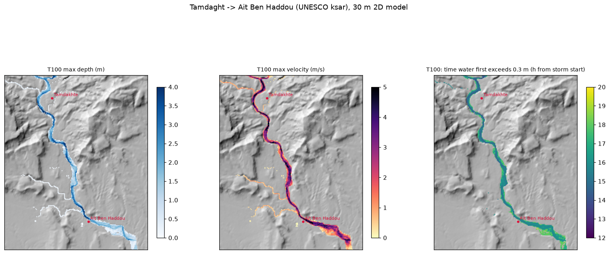
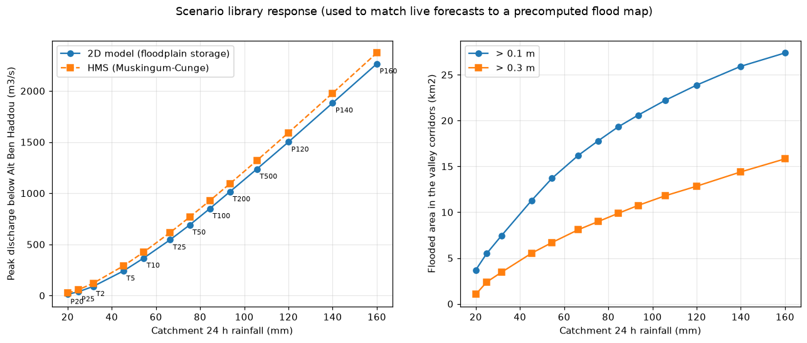

# 2D hydraulics (Phase 3)

## Reproduce

```bash
python -m pipeline.hydraulics.scenarios          # 13-storm library, ~35 min  -> data/runs/hydraulics/
python -m pipeline.hydraulics.hec_ras_export     # HEC-RAS 2D cross-check package -> hec/ras/
python -m pipeline.hydraulics.figures            # docs/figures/phase3_*.png
python -m pytest tests/test_lisflood.py          # analytical normal-depth + dry-domain tests
```

## Solver

`pipeline/hydraulics/lisflood2d.py`: the local-inertia shallow-water formulation of Bates, Horritt & Fewtrell (2010), as in LISFLOOD-FP.
- **Grid and time step:** explicit, on 30 m cells; dt = 0.7·Δx/√(g·h_max).
- **Friction:** semi-implicit Manning friction on cell faces.
- **Froude limit:** discharge across a face is capped at Froude 1 for the steep wadi reaches.
- **Cell velocity:** computed from face discharges and capped at Froude 1.5 of the local depth. Without the cap, a barely wet cell next to a deep face produced physically impossible velocities (up to 92 m/s in the first P140 run).
- **Outputs per scenario:** maximum depth, maximum velocity, maximum d·(v+0.5), time water first exceeds 0.1 m and 0.3 m, duration above 0.3 m, and depth every 30 minutes.

**Verification** (`tests/test_lisflood.py`):
- A tilted channel (slope 0.01, n = 0.035, 60 m³/s) reaches the Manning normal depth within 5%, outflow equals inflow within 3%, and the mass error is under 1%.
- Every library run closes its mass balance to 10⁻⁴ or better.

## Domain and terrain

**Domain:** 101.6 km² of valley corridors (112,889 cells). These are catchment cells within 1,050 m of a channel draining at least 2 km² and at most 20 m above the nearest drainage (HAND). A 2.1 km extension below Aït Ben Haddou keeps the outflow boundary away from the ksar. Hillslopes stay in the hydrology model.

**Terrain:** raw Copernicus GLO-30. GLO-30 is a radar DSM, and narrow gorges carry spurious highs from radar shadow, vegetation and bridges. Filling behind them would create artificial reservoirs, so the flow paths are **breached instead of filled**:
- Every D8 path draining at least 0.25 km² is carved so its bed never rises downstream.
- Diagonal D8 steps are made 4-connected for the solver's faces.
- A 4-connected priority flood (Barnes et al. 2014) from the outflow boundary removes the remaining pits.
- Result: 5% of cells were lowered (median 0.8 m), and only 1.1% raised (median 0.3 m).

**Coupling with the hydrology** (as HEC-RAS uses HMS inflows):
- Each sub-basin's *local* HMS hydrograph enters the 2D grid spread over the cells where its hillslopes drain (D8 tracing; 100% of the catchment mapped).
- Routing between sub-basins is done by the 2D model.
- Roughness comes from the Phase 1 Manning grid (channel n = 0.045).

## Scenario library

Design storms (central rainfall, IMERG storm shape), outlet storm area:

| Storm | 24 h rain (mm) | 2D peak below outlet (m³/s) | HMS peak (m³/s) | Flooded > 0.1 m (km²) | > 0.3 m (km²) | Max depth (m) | Max velocity (m/s) |
|---|---|---|---|---|---|---|---|
| P20 | 20.0 | 12 | 24 | 3.7 | 1.0 | 0.67 | 1.7 |
| P25 | 25.0 | 38 | 58 | 5.5 | 2.4 | 1.16 | 2.6 |
| T2 | 31.6 | 89 | 120 | 7.4 | 3.4 | 1.79 | 3.2 |
| T5 | 45.3 | 241 | 290 | 11.3 | 5.5 | 2.84 | 4.3 |
| T10 | 54.5 | 367 | 425 | 13.7 | 6.7 | 3.40 | 4.8 |
| T25 | 66.4 | 545 | 616 | 16.2 | 8.1 | 3.99 | 5.6 |
| T50 | 75.3 | 690 | 767 | 17.8 | 9.0 | 4.40 | 6.1 |
| T100 | 84.4 | 850 | 928 | 19.3 | 9.9 | 4.78 | 6.6 |
| T200 | 93.5 | 1015 | 1093 | 20.6 | 10.7 | 5.13 | 6.9 |
| T500 | 105.7 | 1236 | 1320 | 22.2 | 11.8 | 5.59 | 7.2 |
| P120 | 120.0 | 1501 | 1591 | 23.9 | 12.9 | 6.21 | 7.5 |
| P140 | 140.0 | 1883 | 1978 | 25.9 | 14.4 | 7.04 | 8.1 |
| P160 | 160.0 | 2265 | 2371 | 27.4 | 15.8 | 7.75 | 8.7 |

**2D peaks are 8–25% below the HMS peaks.** Real floodplain storage attenuates more than HMS's single rectangular channel, and the effect is largest for small floods, where the wide gravel beds absorb a big share of the volume. This is consistent with the "attenuated floods" of the Marghène described by Saidi et al. (2006).

Domain-edge cells wetter than 0.3 m are 0.2–3.3% of edge cells. These are almost all channel heads, where upstream inflow enters, not floodplain cut off by the domain edge.

## HEC-RAS cross-check

- **Package:** `hec/ras/Ounila_reach/` covers the reach from Tamdaght to Aït Ben Haddou, including the UNESCO ksar. It contains the same terrain, roughness and T100 branch inflows, plus this solver's answer for the same set-up.
- **Instructions:** `hec/ras/README.md`.
- **Targets:** extent F ≥ 0.7 and peak outflow within ±10%.
- **This solver's answer for that set-up:** inflow peaks 456 m³/s (Tazlaft) and 443 m³/s (Taifest), outflow peak 882 m³/s, 1.74 km² flooded above 0.1 m, max depth 4.9 m.
- **Status:** waiting for an HEC-RAS run (not installed on the development machine).




## Limitations

- **30 m grid:** gorges narrower than one cell are represented by a carved single-cell channel.
- **Local inertia vs SWE:** local inertia neglects advection. Velocities in supercritical gorge reaches are Froude-limited, so they are conservative for depth and low for velocity.
- **Recession:** the lateral inflows use the Clark hydrograph timing of each sub-basin outlet for every cell they enter, which slightly advances inflow to cells far upstream within a sub-basin.
